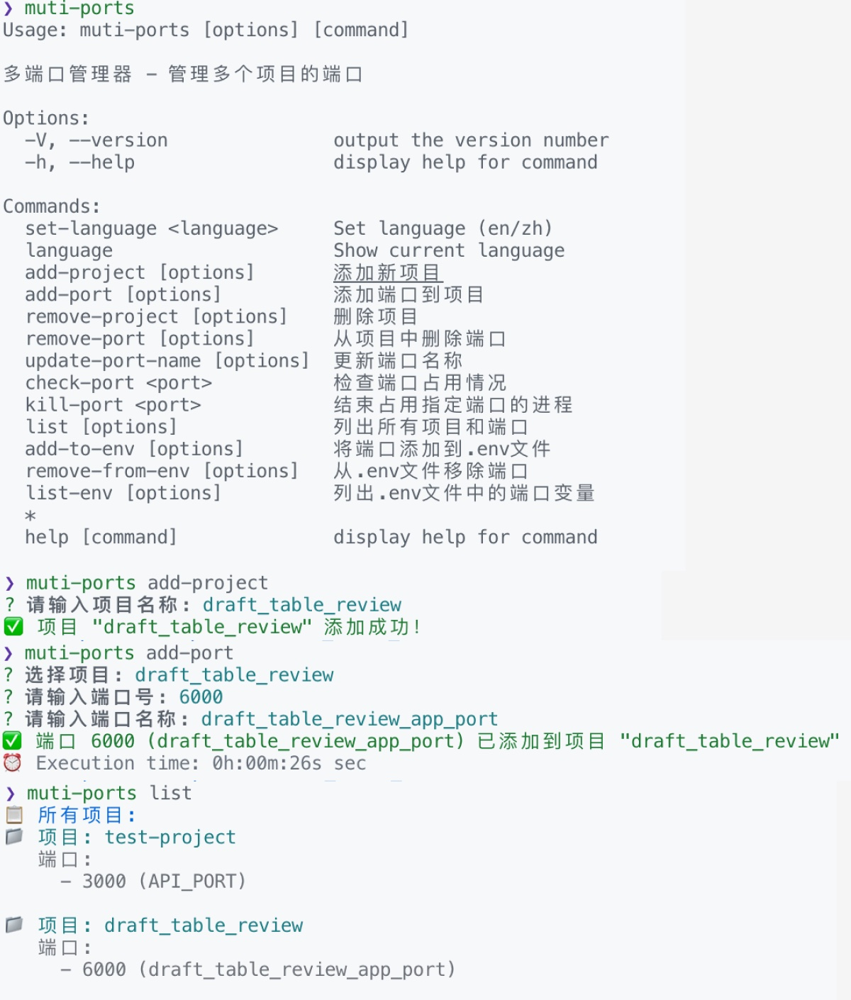

# 多端口管理器

[![NPM 版本][npm-image]][npm-url]
[![下载统计][npm-downloads]][npm-url]
[![许可证][license-image]][license-url]

一个可以管理多个项目所占用端口的 npm CLI 工具，支持 TypeScript。

**[English](README.md)** | **[中文文档](README_ZH.md)**

<!-- 目录 -->
<details>
<summary>目录</summary>
<ol>
<li><a href="#关于项目">关于项目</a></li>
<li><a href="#技术栈">技术栈</a></li>
<li><a href="#快速开始">快速开始</a></li>
<li><a href="#使用方法">使用方法</a></li>
<li><a href="#开发路线">开发路线</a></li>
<li><a href="#贡献指南">贡献指南</a></li>
<li><a href="#许可证">许可证</a></li>
<li><a href="#联系方式">联系方式</a></li>
<li><a href="#致谢">致谢</a></li>
</ol>
</details>

## 关于项目



**当前版本: 1.1.0** | [更新日志](CHANGELOG.md) | [报告问题](https://github.com/AHappyAtlas/muti-ports-manager/issues)

市面上有很多优秀的端口管理工具；但是，我没有找到一个真正适合我需求的工具，能够管理多个项目、命名端口并集成环境变量。所以我创建了这个增强版本。

以下是多端口管理器的特别之处：

* **你的时间应该专注于** 创造令人惊叹的东西。一个解决端口冲突并帮助高效管理开发环境的项目
* **你不应该重复做同样的任务** 比如手动检查端口可用性和更新 .env 文件
* **智能端口管理** 具有自动检测、命名和环境变量集成功能
* **跨平台支持** 支持 Windows、macOS 和 Linux

### 功能特性

- 🚀 **多项目管理**: 为不同项目分配和管理端口
- 🔧 **端口名称**: 每个端口都有可自定义的名称
- 📝 **环境变量管理**: 自动将端口信息添加到.env文件
- 🖥️ **跨平台支持**: 支持 Windows、macOS 和 Linux
- 💻 **进程管理**: 查看和终止占用端口的进程
- 🎯 **智能检测**: 自动检测端口占用情况
- 🌍 **国际化支持**: 支持英文和中文语言
- ⚡ **增强CLI**: 改进的错误处理和用户体验
- 🔒 **数据持久化**: 可靠的项目和端口数据存储
- 📊 **实时状态**: 实时端口占用信息

<p align="right">(<a href="#readme-top">返回顶部</a>)</p>

## 技术栈

本节列出了用于启动此项目的主要框架/库。

* [Node.js](https://nodejs.org/)
* [TypeScript](https://www.typescriptlang.org/)
* [Commander.js](https://github.com/tj/commander.js)
* [Chalk](https://github.com/chalk/chalk)
* [Inquirer](https://github.com/SBoudrias/Inquirer.js)
* [Portfinder](https://github.com/http-party/node-portfinder)
* [PS List](https://github.com/sindresorhus/ps-list)
* [Dotenv](https://github.com/motdotla/dotenv)

<p align="right">(<a href="#readme-top">返回顶部</a>)</p>

## 快速开始

这是一个关于如何在本地设置项目的示例说明。要获得本地副本并运行，请按照以下简单示例步骤操作。

### 快速安装

```bash
# 从 npm 全局安装
npm install -g muti-ports-manager

# 立即开始使用
muti-ports --help
```

### 开发安装

1. **克隆仓库**
   ```bash
   git clone https://github.com/AHappyAtlas/muti-ports_manager.git
   ```

2. **安装 NPM 包**
   ```bash
   npm install
   ```

3. **构建项目**
   ```bash
   npm run build
   ```

4. **全局安装（可选）**
   ```bash
   npm install -g muti-ports-manager
   ```

5. **更改 git 远程 URL 以避免意外推送到基础项目**
   ```bash
   git remote set-url origin AHappyAtlas/muti-ports-manager
   git remote -v # 确认更改
   ```

<p align="right">(<a href="#readme-top">返回顶部</a>)</p>

## 使用方法

使用此空间展示项目如何使用的有用示例。额外的截图、代码示例和演示在此空间中效果很好。

### 基本命令

```bash
# 添加项目
muti-ports add-project

# 添加端口到项目
muti-ports add-port

# 列出所有项目和端口
muti-ports list

# 检查端口占用
muti-ports check-port 3000

# 终止占用端口的进程
muti-ports kill-port 3000
```

### 语言管理

```bash
# 设置为英文
muti-ports set-language en

# 设置为中文
muti-ports set-language zh

# 显示当前语言
muti-ports language
```

### 端口名称管理

```bash
# 添加带名称的端口
muti-ports add-port -p myproject -P 3000 -N API_PORT

# 更新端口名称
muti-ports update-port-name -p myproject -P 3000 -N NEW_API_PORT

# 删除端口
muti-ports remove-port -p myproject -P 3000
```

### 环境变量管理

```bash
# 将端口添加到.env文件
muti-ports add-to-env -n API_PORT

# 指定项目和.env文件路径
muti-ports add-to-env -p myproject -e .env.local -n API_PORT

# 从.env文件移除端口
muti-ports remove-from-env -n API_PORT

# 列出.env文件中的端口变量
muti-ports list-env

# 指定.env文件路径
muti-ports list-env -e .env.production
```

### 命令选项

#### add-project
- `-n, --name <name>`: 项目名称

#### add-port
- `-p, --project <name>`: 项目名称
- `-P, --port <port>`: 端口号
- `-N, --name <name>`: 端口名称

#### update-port-name
- `-p, --project <name>`: 项目名称
- `-P, --port <port>`: 端口号
- `-N, --name <name>`: 新的端口名称

#### add-to-env
- `-p, --project <name>`: 项目名称
- `-e, --env-file <path>`: .env文件路径
- `-n, --name <name>`: 端口名称

#### remove-from-env
- `-e, --env-file <path>`: .env文件路径
- `-n, --name <name>`: 端口名称

#### list-env
- `-e, --env-file <path>`: .env文件路径

#### set-language
- `<language>`: 语言代码 (en/zh)

### 环境变量格式

端口名称会自动转换为全大写格式添加到.env文件中：

```env
# 如果端口名称为 "API_PORT"，端口号为 3000
API_PORT=3000

# 如果端口名称为 "db_port"，端口号为 5432
DB_PORT=5432
```

_更多示例，请参考 [文档](https://github.com/AHappyAtlas/muti-ports-manager)_

<p align="right">(<a href="#readme-top">返回顶部</a>)</p>

## 开发路线

- [x] 多项目端口管理
- [x] 端口命名系统
- [x] 环境变量集成
- [x] 跨平台支持
- [x] 国际化（英文/中文）
- [x] 增强的CLI界面和错误处理
- [ ] 端口管理 Web 仪表板
- [ ] Docker 集成
- [ ] 端口冲突解决建议


查看 [开放问题](https://github.com/AHappyAtlas/muti-ports-manager/issues) 了解完整的功能列表（和已知问题）。

<p align="right">(<a href="#readme-top">返回顶部</a>)</p>

## 贡献指南

贡献是使开源社区成为学习、启发和创造的令人惊叹的地方的原因。你做出的任何贡献都**非常感激**。

如果你有一个让这个项目变得更好的建议，请 fork 仓库并创建 pull request。你也可以简单地打开一个带有"enhancement"标签的问题。别忘了给项目一个星标！再次感谢！

1. Fork 项目
2. 创建你的功能分支 (`git checkout -b feature/AmazingFeature`)
3. 提交你的更改 (`git commit -m '添加一些 AmazingFeature'`)
4. 推送到分支 (`git push origin feature/AmazingFeature`)
5. 打开 Pull Request

### 顶级贡献者：

[![贡献者][contributors-shield]][contributors-url]

<p align="right">(<a href="#readme-top">返回顶部</a>)</p>

## 许可证

根据 MIT 许可证分发。有关更多信息，请参阅 `LICENSE`。

<p align="right">(<a href="#readme-top">返回顶部</a>)</p>

## 联系方式

Email - [younixiao@gmail.com](mailto:younixiao@gmail.com )

项目链接: [https://github.com/AHappyAtlas/muti-ports-manager](https://github.com/AHappyAtlas/muti-ports-manager)

<p align="right">(<a href="#readme-top">返回顶部</a>)</p>

## 致谢

使用此空间列出你发现有用并想要致谢的资源。我包含了一些我最喜欢的内容来开始！

* [选择开源许可证](https://choosealicense.com)
* [GitHub Emoji 备忘单](https://www.webpagefx.com/tools/emoji-cheat-sheet)
* [Malven's Flexbox 备忘单](https://flexbox.malven.co/)
* [Malven's Grid 备忘单](https://grid.malven.co/)
* [Img Shields](https://shields.io)
* [GitHub Pages](https://pages.github.com)
* [Font Awesome](https://fontawesome.com)
* [React Icons](https://react-icons.github.io/react-icons/)

<p align="right">(<a href="#readme-top">返回顶部</a>)</p>

## 版本历史

- **v1.1.0** (当前版本) - 增强的CLI界面，改进的错误处理和更好的用户体验
- **v1.0.0** - 具有核心功能的初始版本

详细变更请查看 [CHANGELOG.md](CHANGELOG.md)。

## 开发

```bash
# 安装依赖
npm install

# 构建项目
npm run build

# 开发模式运行
npm run dev

# 运行构建后的版本
npm start
```

## 项目结构

```
src/
├── types.ts          # TypeScript 类型定义
├── project-manager.ts # 项目管理器
├── port-manager.ts   # 端口管理器
├── env-manager.ts    # 环境变量管理器
├── manager.ts        # 主管理器
├── i18n/
│   └── index.ts     # 国际化管理器
├── index.ts          # 入口文件
└── bin/
    └── muti-ports.ts # CLI 入口
```

## 数据存储

项目数据存储在用户主目录下的 `.muti-ports-manager/projects.json` 文件中。

## 国际化

工具支持多种语言：
- **英文 (en)**: 默认语言
- **中文 (zh)**: 完整的中文本地化

可以使用 `set-language` 命令在运行时更改语言。

<!-- MARKDOWN 链接和图片 -->
<!-- https://www.markdownguide.org/basic-syntax/#reference-style-links -->
[npm-image]: https://img.shields.io/npm/v/muti-ports-manager.svg?style=flat-square
[npm-url]: https://npmjs.org/package/muti-ports-manager
[npm-downloads]: https://img.shields.io/npm/dm/muti-ports-manager.svg?style=flat-square
[license-image]: https://img.shields.io/npm/l/muti-ports-manager.svg?style=flat-square
[license-url]: https://github.com/AHappyAtlas/muti-ports-manager/blob/main/LICENSE
[contributors-shield]: https://img.shields.io/github/contributors/AHappyAtlas/muti-ports-manager.svg?style=flat-square
[contributors-url]: https://github.com/AHappyAtlas/muti-ports-manager/graphs/contributors